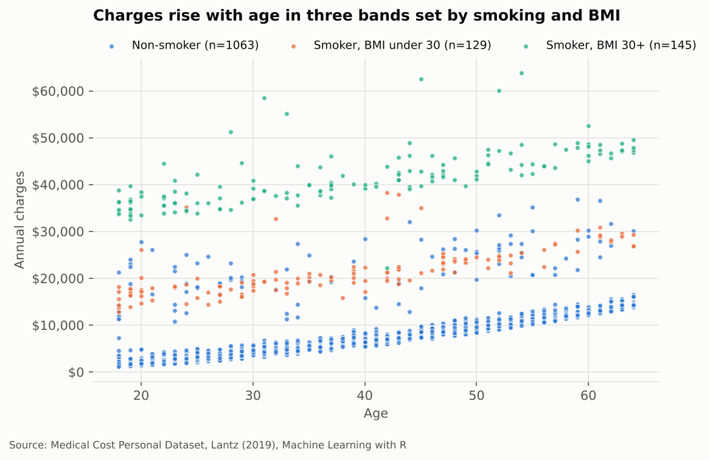
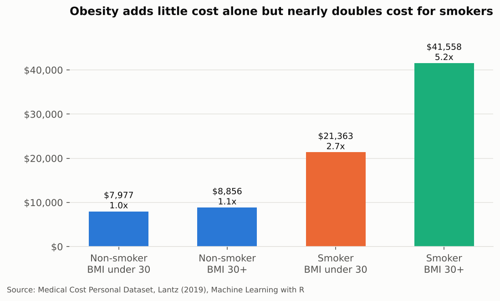
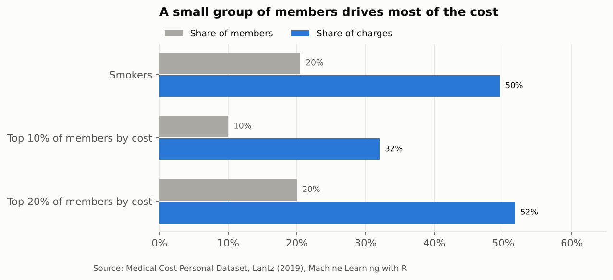

# Healthcare Cost Driver Analysis: Health Insurance Charges

Identifies what drives annual medical charges for 1,337 insured members and quantifies how much of total cost sits in a small, high-risk segment. Built with SQL (DuckDB), Python, and multiple linear regression.

| | |
|---|---|
| **Industry** | Healthcare / Health Insurance |
| **Tools** | SQL (DuckDB), Python, pandas, statsmodels, matplotlib |
| **Techniques** | Data quality profiling, segmentation, cost concentration (Pareto), interaction effects, OLS regression with confidence intervals |
| **Data** | Medical Cost Personal Dataset (1,338 members, 7 fields) |

---

## 1. Business Questions

1. Which member characteristics drive annual charges?
2. How concentrated is total cost across the member population?
3. Do risk factors combine additively, or does one amplify another?

## 2. Key Findings

| # | Finding | Evidence |
|---|---|---|
| 1 | Smokers are 20.5% of members but 49.5% of total charges. | `outputs/tables/02_cost_concentration.csv` |
| 2 | The top 10% of members by cost account for 32% of charges, and 97.8% of them are smokers. | Same table |
| 3 | Obesity alone adds little cost (non-smokers: $8,856 vs $7,977, 1.1x). For smokers, obesity nearly doubles cost ($41,558 vs $21,363). | `outputs/tables/03_risk_segments.csv` |
| 4 | Adding a smoker x obesity interaction raises model R-squared from 0.756 to 0.864 and cuts prediction error (RMSE) from $6,005 to $4,486. | `outputs/tables/06_model_fit.csv` |
| 5 | Holding other factors constant, each year of age adds about $263 per year (95% CI $246 to $280). | `outputs/tables/07_model_coefficients.csv` |
| 6 | Region and sex have small effects (under $1,300) compared with smoking status (about $13,400, plus $19,800 when combined with BMI 30+). | Same table |

**Business implication:** A wellness or care management program that targets smokers with BMI 30+ (10.8% of members) reaches the segment with the highest cost. Smoking cessation in that group carries more cost impact than weight management alone in non-smokers.

## 3. Results

### 3.1 Three cost bands by age



### 3.2 Smoking and obesity interaction



### 3.3 Cost concentration



### 3.4 Regression model (OLS, dependent variable: annual charges in USD)

| Term | Coefficient (USD) | 95% CI | p-value |
|---|---:|---|---:|
| Smoker | 13,402 | 12,531 to 14,274 | < 0.001 |
| Smoker x BMI 30+ | 19,794 | 18,597 to 20,991 | < 0.001 |
| BMI 30+ (non-smoker) | -863 | -1,699 to -27 | 0.043 |
| Age (per year) | 263 | 246 to 280 | < 0.001 |
| BMI (per point) | 115 | 47 to 183 | < 0.001 |
| Children (per dependent) | 520 | 320 to 720 | < 0.001 |
| Male (vs female) | -490 | -974 to -6 | 0.047 |
| Region: southwest (vs northeast) | -1,224 | -1,918 to -530 | < 0.001 |

Model fit: R-squared 0.864, adjusted R-squared 0.863, RMSE $4,486. Full output in `outputs/tables/07_model_coefficients.csv`.

## 4. Method

| Step | File | Description |
|---|---|---|
| Staging | `sql/00_staging.sql` | Loads raw data, removes exact duplicates, derives age bands, WHO BMI classes, and risk segments |
| Data quality | `sql/01_data_quality.sql` | Row counts, duplicates, nulls, value ranges |
| Concentration | `sql/02_cost_concentration.sql` | Share of members vs share of charges, cost deciles with `NTILE()` |
| Segments | `sql/03_risk_segments.sql` | Smoker x BMI segments with cost multiple vs baseline |
| Age | `sql/04_age_by_segment.sql` | Average charges by age band and risk segment |
| Secondary factors | `sql/05_region_sex_children.sql` | Region, sex, dependents |
| Model | `src/run_analysis.py` | Two OLS models compared (with and without interaction) |

## 5. Data Quality

| Check | Result |
|---|---|
| Raw rows | 1,338 |
| Exact duplicate rows removed | 1 |
| Rows analyzed | 1,337 |
| Null values | 0 |
| Age range | 18 to 64 |
| Charges range | $1,122 to $63,770 |

## 6. Limitations

- Cross-sectional data. Results show association, not causation.
- The dataset has no diagnosis, utilization, or plan design fields, so cost differences cannot be attributed to specific services.
- Residuals are not normally distributed (charges are right-skewed). Coefficients are used for direction and magnitude, not for precise prediction.

## 7. Repository Structure

```
healthcare-insurance-cost-analysis/
├── data/raw/insurance.csv
├── sql/
│   ├── 00_staging.sql
│   ├── 01_data_quality.sql
│   ├── 02_cost_concentration.sql
│   ├── 03_risk_segments.sql
│   ├── 04_age_by_segment.sql
│   └── 05_region_sex_children.sql
├── src/
│   ├── run_analysis.py
│   └── style.py
├── outputs/
│   ├── figures/
│   └── tables/
└── requirements.txt
```

## 8. How to Run

```bash
pip install -r requirements.txt
python src/run_analysis.py
```

## 9. Data Source

Medical Cost Personal Dataset, from Lantz, B. (2019). *Machine Learning with R*, 3rd ed. Packt. Public copy: https://github.com/stedy/Machine-Learning-with-R-datasets
